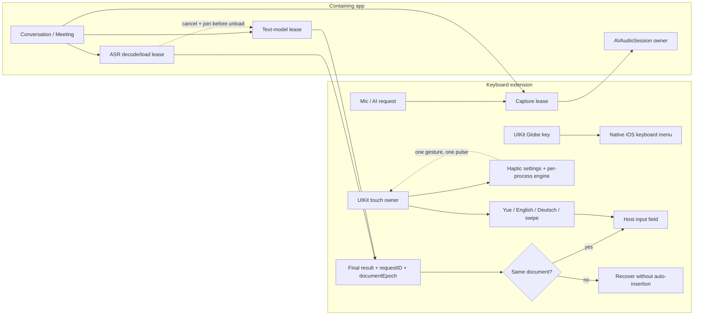
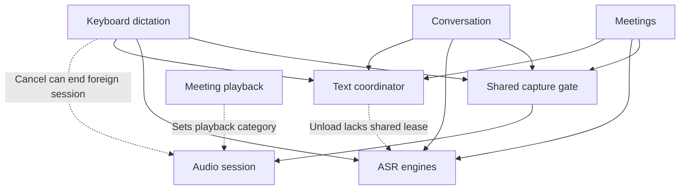
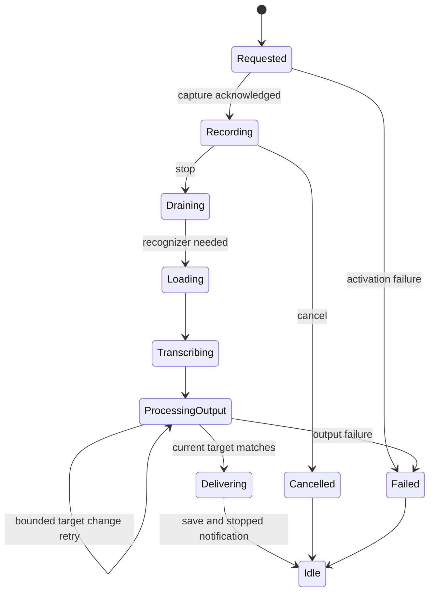
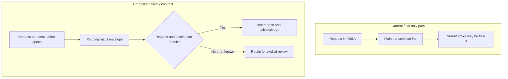
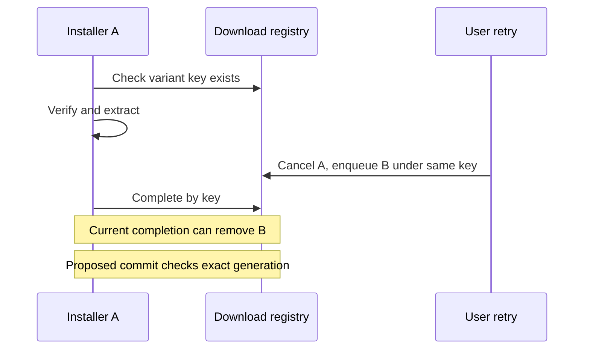
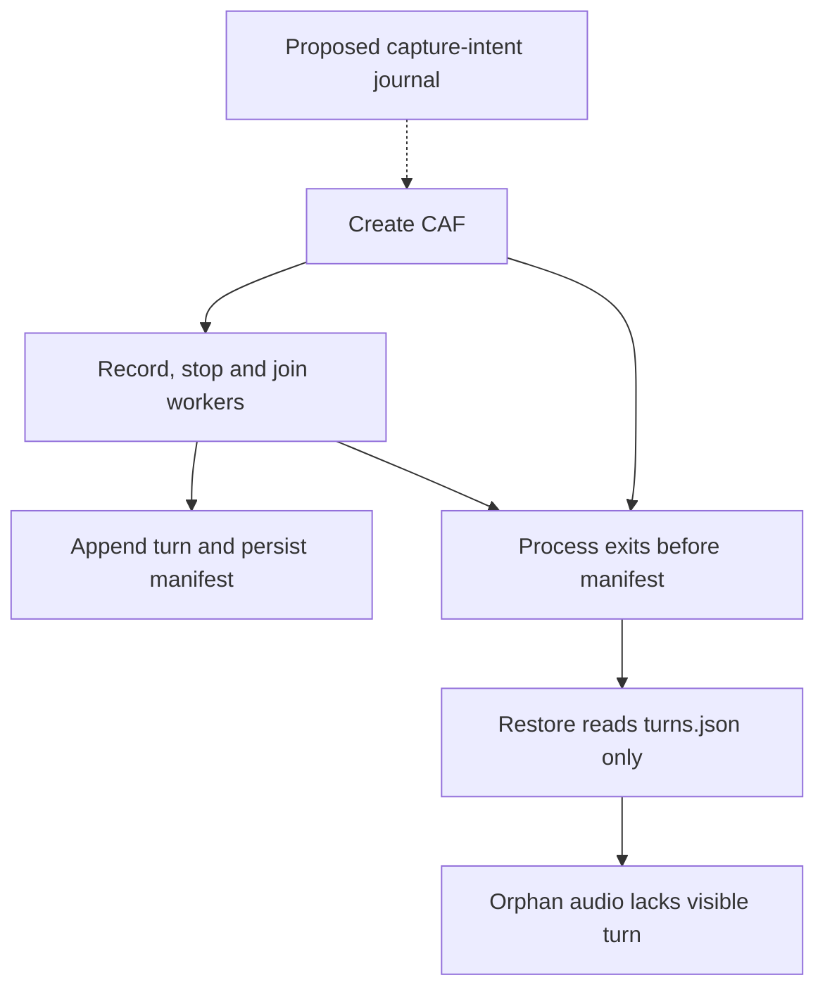
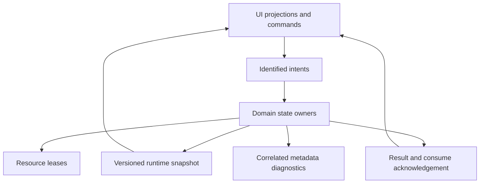

# Altboard-Canto runtime state workflow

Source baseline: Build 193 (`2157207`, failed before Xcode). This audit inferred 44 state families, 29 relationships, and 16 risks. Inspected later `main` `cdccc29f5751531b10b9308f47b1f27369054fc3` produced successful Build 199, but older risks and physical iPhone operation require fresh verification.

Canonical machine model: [`state-machines.json`](./state-machines.json). Existing [`APP-STRUCTURE.json`](../APP-STRUCTURE.json) and [`SETTINGS-WORKFLOW-TREE.md`](../SETTINGS-WORKFLOW-TREE.md) are navigation documents, not runtime reachability proofs.

## Input, output and shared resource map

## Build 193 diagrams (historical source-derived states)

### Current resource relationships

Classification: `current_source_model`; proposed edges are not implemented simply because they are drawn.

### Current dictation phases

Classification: `current_source_model`; proposed edges are not implemented simply because they are drawn.

### Current delivery gap and proposed contract

Classification: `current_and_proposed`; proposed edges are not implemented simply because they are drawn.

### Download cancellation crosses an install boundary

Classification: `current_and_proposed`; proposed edges are not implemented simply because they are drawn.

### Conversation crash-recovery window

Classification: `current_and_proposed`; proposed edges are not implemented simply because they are drawn.

### Proposed domain ownership

Classification: `recommendation`; proposed edges are not implemented simply because they are drawn.

## Maintenance contract

Each domain has one writer. Request/owner/generation bounds cancellation and async completions. Model inference and decoding use shared leases. Insertions require matching field identity; unknown destinations retain results for manual recovery. Globe remains native iOS; haptics use per-process generation-aware lifecycle. Diagnostics omit sensitive user content.

The seven E01–E07 reviews are submachine candidates, not seven newly verified state families. Check latest main first and update the JSON only with evidence. The Settings tree is generated from APP-STRUCTURE.json, not hand-edited.
