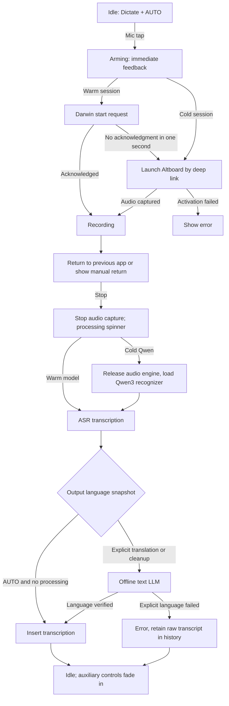

# Dictation state machine (Compose removed)

## Invariants and diagnostic checkpoints

- Keyboard owns immediate Arming feedback and hides auxiliary controls. Only actual audio capture acknowledgment enables the recording waveform.
- Main app owns AVAudioSession, captured audio, model initialization, ASR, optional translation, final text bridge, and history.
- Cold Qwen3 recording starts *before* loading the native ONNX model. At stop, release the audio engine before deferred recognizer loading. This reduces startup latency and preserves first words.
- The warm Darwin start request falls back to app deep link after one second. Duplicate deep links reuse active recording and attempt host return once per token.
- Mode is always Dictate. Compose, WRITE, writing presets, their UI, and their processing routines are removed.
- Output target AUTO / 粵 / EN / DE, cleanup, and register are snapshotted at recording start. Explicit translated output never silently inserts the wrong-language raw ASR result.
- No stale-audio watchdog interrupts a live recording merely because input amplitude is constant.
- Other controls fade out while arming/recording/processing, then return. Emoji replaces the duplicate globe key, with a long-press keyboard-switch fallback.
- Automatic keyboard AI cannot re-process already-transformed text. Manual AI, Undo/Redo and Repeat Delete remain.
- Qwen's leading `language Cantonese<asr_text>` decoder metadata is stripped without changing spoken text.

## Device regression matrix

| Scenario | Expected result |
| --- | --- |
| Cold host app + cold Qwen3 | Visible arming, record immediately after AVAudioSession activates, return requested |
| Warm host app | Darwin recording, deep-link fallback after one second if no ack |
| Duplicate deep link | No restarted capture; host return attempted once |
| Silence >2 seconds | Recording continues |
| Arming and recording | Non-mic controls hidden; mic stays active |
| Stop and ASR processing | Spinner shown until text or error; controls return |
| AUTO English voice | English when ASR recognizes English |
| DE selected, Cantonese speech | German translation or error, never raw Cantonese |
| Missing offline text model | Original captured in history; visible translation error |
| ASR emits Qwen header | Control header removed, real speech preserved |
| Emoji | Opens Emoji keyboard; long press for keyboard switch when necessary |
| Manual AI, undo/redo, long delete | Existing behavior retained |

## Limits
- App-to-host activation uses private iOS APIs and cannot be guaranteed. The manual return hint must remain available.
- iOS can suspend ASR/LLM after returning to another app. Background tasks are finite.
- AUTO follows recognized transcript language; a wrongly recognized speech language cannot be reconstructed from text alone.
- IPA compilation cannot substitute for real-device cold start and background-session testing.
