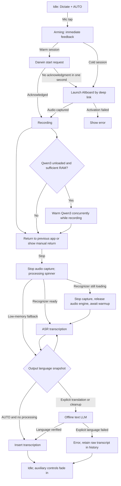

# Dictation state machine (Compose removed)

## Invariants and diagnostic checkpoints

- Keyboard owns immediate Arming feedback and hides auxiliary controls. Only actual audio capture acknowledgment enables the recording waveform.
- Main app owns AVAudioSession, captured audio, model initialization, ASR, optional translation, final text bridge, and history.
- Cold Qwen3 recording starts *before* loading the native ONNX model. After capture starts, a short delay allows the host-return action to proceed; Qwen3 then warms in a detached native task during recording if at least its declared RAM requirement plus 512 MB is available. Otherwise loading is deferred until stop.
- If the user stops while a concurrent load is in progress, stop finalization releases the audio engine, joins the existing model-initialization task, then decodes the captured audio. Waiters share one recognizer and complete load state exactly once.
- The warm Darwin start request falls back to app deep link after one second. Duplicate deep links reuse active recording and attempt host return once per token.
- Mode is always Dictate. Compose, WRITE, writing presets, their UI, and their processing routines are removed.
- Output target AUTO / 粵 / EN / DE, cleanup, and register are snapshotted at recording start. Explicit translated output never silently inserts the wrong-language raw ASR result.
- No stale-audio watchdog interrupts a live recording merely because input amplitude is constant.
- Other controls fade out while arming/recording/processing, then return. Emoji replaces the duplicate globe key, with a long-press keyboard-switch fallback.
- Automatic keyboard AI cannot re-process already-transformed text. Manual AI, Undo/Redo and Repeat Delete remain.
- Qwen's leading `language Cantonese<asr_text>` decoder metadata is stripped without changing spoken text.

## Device regression matrix

| Scenario | Expected result |
| --- | --- |
| Cold host app + cold Qwen3 | Visible arming, record immediately after AVAudioSession activates, return requested; Qwen3 warmup starts during speech when memory permits |
| Warm host app | Darwin recording, deep-link fallback after one second if no ack |
| Duplicate deep link | No restarted capture; host return attempted once |
| Silence >2 seconds | Recording continues |
| Arming and recording | Non-mic controls hidden; mic stays active |
| Stop and ASR processing | If Qwen3 is already ready, skip loading; if loading, await the same task; otherwise initialize after stop |
| AUTO English voice | English when ASR recognizes English |
| DE selected, Cantonese speech | German translation or error, never raw Cantonese |
| Missing offline text model | Original captured in history; visible translation error |
| ASR emits Qwen header | Control header removed, real speech preserved |
| Emoji | Opens Emoji keyboard; long press for keyboard switch when necessary |
| Manual AI, undo/redo, long delete | Existing behavior retained |

## Limits
- App-to-host activation uses private iOS APIs and cannot be guaranteed. The manual return hint must remain available.
- iOS can suspend ASR/LLM after returning to another app. The active audio session supports background recording but does not guarantee unrestricted CPU inference or arbitrary background model warmup. Background tasks are finite.
- Live partial transcription is not implemented. Qwen3 currently uses sherpa-onnx's offline recognizer, so incremental text requires a separate chunked/streaming design with stable partial-result merging.
- AUTO follows recognized transcript language; a wrongly recognized speech language cannot be reconstructed from text alone.
- IPA compilation cannot substitute for real-device cold start and background-session testing.

## Post-recording status and raw text preview

- The main app publishes processing stages through an App Group JSON file and Darwin notification: stopping audio, loading speech model, transcribing, translating/cleaning up, and finalizing.
- A muted status **below the keyboard keys** shows the real stage and elapsed seconds. No fabricated percentage appears because the installed Qwen3 ONNX model loader and offline decoder do not expose fractional completion.
- Once ASR finishes, the raw, unmodified recognized speech appears in a two-line preview **before** optional translation or cleanup completes. The raw preview is not inserted into the host's text field.
- Progress is scoped by the dictation session token. New recordings clear previous progress; completed sessions clear it. The keyboard ignores stale tokens and old updates.
- A deterministic formatter converts clearly recognized technical quantities such as "one point seven gigabytes" to "1.7 GB" or "two point five gigahertz" to "2.5 GHz". It distinguishes gigabits (Gb) from gigabytes (GB). It cannot reconstruct any digit the ASR omitted.
- Real device checks: stop after cold model warmup, return to WhatsApp during transcription, inspect elapsed time, confirm raw preview persists through cleanup, confirm controls fade back when the final text arrives, and repeat with DE output translation and with no offline LLM installed.

## Preferred languages and adaptive keyboard (November 2026)

- The user's chosen spoken languages are persisted globally at first-run onboarding and editable in Voice Output settings; model-specific Whisper/Parakeet preferences remain separate where those engines accept a decoder language hint.
- The output key cycles AUTO plus the preferred languages. Other preferences map to the existing custom-language translation target without downloading an additional speech model.
- Qwen3 ONNX auto-detects and has **no native language-lock API** here. A wrong-script guard rejects clearly unexpected Thai or other scripts and preserves the audio in History instead of inserting them; it cannot repair the original audio recognition, and it does not claim to distinguish Cantonese from Mandarin using Han characters alone.
- The keyboard height can be adjusted in Settings (70–110%); default 92% is slightly shorter than the former layout. Under 82%, the standard microphone changes to a horizontal pill with a minimum 44-point tap target. The setting takes effect when the extension reopens, within iOS layout bounds.
- The height preview updates while dragging the slider. In both layouts, the processing text is horizontally centered **immediately after the mic row**, before the lower controls return.
- The recording icon is accompanied by a left-to-right 17-sample audio-level history from the real AVAudioEngine RMS tap (30 Hz source, 20 Hz display), including quiet/speaking indication. Silent input produces a flat line; unlike the previous animation, the trace is not synthesized from a sine wave.
- Audio polling is rearmed when the keyboard returns from Altboard to the host app, including if the initial Darwin start notification was missed.
- Removed obsolete custom globe-display state and empty diagnostic reads; essential crash/ASR diagnostics are kept for troubleshooting rather than deleting evidence.

## Layout and personal correction pass (November 2026)

- The screenshot's unwanted **top gap** came from the old pulse-ring view reserving its full outer-ring height before the circular microphone and from 14.5pt top padding. The revised layout overlays rather than reserves the pulse rings and reduces top padding to 3pt.
- A standard keyboard now has three fixed rows: microphone, settings + language | status | AI + delete, and Emoji/trash/space/return. Status never inserts another row or changes key height.
- The height slider changes total extension height and surrounding whitespace only. All normal keys remain 45pt; the 106pt circular microphone stays full size. Under 90%, it switches to a 56pt-high, wide pill without making other buttons smaller. The preview mirrors fixed control sizes.
- While controls fade out, status expands across the control row. With controls visible, No Speech and a clipped final output preview are centered between the two icon pairs. The final inserted text preview lasts five seconds and does not resize WhatsApp or other host input fields.
- In compact mode, status and the clipped final result replace the microphone glyph inside the pill and use a single line. The pill retains the same tap target. Recording continues to show real amplitude.
- Deterministic Cantonese greeting correction changes opening 餵，你... to 喂，你... only in conversational contexts, not feeding words such as 餵食 and 餵你食飯.
- User-defined corrections are an editable local phrase dictionary under Voice Output → Cantonese word corrections. These are exact phrase replacements, *not* retraining or fine-tuning Qwen3; no extra model and no automatic LLM pass required.
- Dynamic status-strip keyboard-height plumbing and duplicate status padding were removed because status no longer occupies a separate vertical row.

### Device regression checklist

1. At 92% compare top vs bottom whitespace; verify the circular mic is centered and all four middle keys remain 45pt.
2. At 88% and 70% verify the mic becomes a wide pill, other controls remain 45pt, and no control overflows the keyboard.
3. Stop with silence: No speech detected must appear between left/right control pairs, not below the buttons.
4. Dictate a sentence with cleanup and DE output: gray processing stage and raw preview occupy the middle row while controls fade; the finished translation appears briefly in the same row after insertion.
5. At 70%, confirm processing state and final output each show one truncated line inside the pill, not in an extra row.
6. Test 餵，你做乜嘢呀 / 餵食 / 餵你食飯 and a manually saved personal phrase correction.
